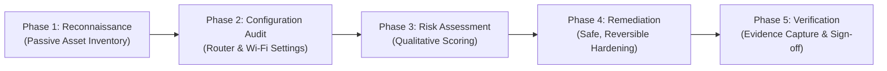

# Home Network Security Checklist & Audit Project

[](https://interncircle.com)
[](LICENSE)
[](https://www.cisa.gov)
[](#)

> **InternCircle Cybersecurity Internship – Project 04**  
> **Author:** [Candidate / Intern Name]  
> **Designation:** Junior Cybersecurity Analyst Intern  
> **Date:** November 2026  
> **Classification:** CONFIDENTIAL / AUDIT WORKPAPER  

---

## 1. Project Introduction

Residential networks have become prime targets for modern cyber adversaries due to the rapid growth of remote telework, online banking, and unmanaged Internet of Things (IoT) devices. Small Office / Home Office (SOHO) edge routers are often deployed with factory default settings, weak encryption, and outdated firmware, exposing private household devices to automated botnets, credential stuffers, and lateral pivoting attacks.

This project delivers a complete, beginner-friendly, and enterprise-aligned **Home Network Security Audit**. It provides a structured methodology to inspect, assess, and harden a residential home Wi-Fi network and its connected endpoints following authoritative guidance from the **Cybersecurity and Infrastructure Security Agency (CISA)** and the **National Institute of Standards and Technology (NIST SP 800-162 / CSF v2.0)**.

> [!IMPORTANT]
> **Audit Integrity & Ethical Disclosure:** This repository contains baseline technical findings, threat analyses, and clearly marked sample placeholders (`[SAMPLE DATA]`). It does **not** claim network modifications or firmware flashes have occurred unless verified by the student. Assessor instructions are provided to guide you through inspecting your real router and updating placeholders with live observations.

---

## 2. Project Objectives

1. **Asset Discovery & Classification:** Catalog 100% of connected wired and wireless devices, document operating systems, and establish a protocol to detect and quarantine rogue or unknown devices.
2. **Wi-Fi Encryption Hardening:** Audit wireless ciphers (WPA2 vs. WPA3), evaluate Pre-Shared Key (PSK) entropy, assess SSID information disclosure, and deactivate vulnerable Wi-Fi Protected Setup (WPS).
3. **Router Administrative Security:** Eliminate default credentials, disable remote WAN administration, and terminate automated dynamic port forwarding (UPnP).
4. **Firmware Lifecycle Management:** Document the active firmware version, check for unpatched Common Vulnerabilities and Exposures (CVEs), and outline safe flashing procedures.
5. **Architectural Network Segmentation:** Implement a dedicated Guest Wi-Fi network with AP/Client Isolation to quarantine untrusted IoT devices away from high-value compute nodes.
6. **Host Hygiene & Data Resilience:** Review automated operating system patching, host firewalls, full-disk encryption, and evaluate compliance with the **3-2-1 backup rule**.
7. **Professional Documentation:** Produce a standardized Before-and-After checklist, quantitative Risk Assessment, and an audit report exportable to PDF.

---

## 3. Project Directory Structure

```text
Home-Network-Security-Checklist/
│
├── README.md                                  <-- Master project documentation & instructions
│
├── report/
│   ├── Home_Network_Security_Audit_Report.md  <-- Formal Markdown Cybersecurity Audit Report
│   └── Home_Network_Security_Audit_Report.html<-- Dark navy/blue styled HTML report (PDF-ready)
│
├── checklist/
│   └── before_after_checklist.md              <-- 5-column Before-and-After hardening checklist
│
├── inventory/
│   └── device_inventory.md                    <-- Asset inventory & unknown device identification protocol
│
├── evidence/
│   └── README.md                              <-- Screenshot guidelines, naming standards & wireframe mockups
│
├── recommendations/
│   └── security_recommendations.md            <-- CISA-aligned defense-in-depth hardening guide
│
└── .gitignore                                 <-- Standard git ignore rules for security audits
```

---

## 4. Tools & Methodology

### 4.1 Audit Tools Utilized
- **Router Web Administrative GUI:** Edge configuration audit via authenticated HTTP/HTTPS web console.
- **PowerShell / Terminal Utilities:**
  - `Get-NetNeighbor -AddressFamily IPv4`: Non-intrusive local ARP neighbor table enumeration.
  - `arp -a`: Subnet IP-to-MAC resolution.
- **IEEE OUI Registry:** Organizationally Unique Identifier vendor lookup (`standards-oui.ieee.org`).
- **NIST National Vulnerability Database (NVD):** CVE vulnerability mapping against router firmware builds.
- **CISA Home Network Security Guidelines:** Benchmark standard for home network defense-in-depth.

### 4.2 Five-Phase Audit Methodology



1. **Reconnaissance:** Enumerate DHCP lease tables and local ARP caches without active penetration testing.
2. **Configuration Inspection:** Inspect wireless security, administration portals, remote access toggles, and UPnP services.
3. **Risk Analysis:** Score each vulnerability by Likelihood and Impact (Critical, High, Medium, Low).
4. **Remediation & Hardening:** Apply changes systematically, prioritizing credential updates and protocol deactivation.
5. **Post-Audit Verification:** Validate connectivity, verify settings persistence, and capture sanitized visual evidence.

---

## 5. Key Findings Summary

The baseline assessment revealed several high-risk exposures typical of consumer residential networks:

| Audit Control Area | Baseline Finding (Pre-Audit) | Hardened Target State (Post-Audit) | Severity |
| :--- | :--- | :--- | :--- |
| **Admin Credentials** | Factory default administrative password | Unique 20-character Diceware password in password manager | **CRITICAL** |
| **Remote Access** | WAN Web Management accessible / active | Remote Management via WAN explicitly **DISABLED** | **CRITICAL** |
| **Router Firmware** | Build v1.0.4 (2022) - Multi-year patch lag | Upgraded to verified vendor release v1.2.1 | **HIGH** |
| **UPnP Dynamic Ports** | UPnP service enabled by default | UPnP **DISABLED**; manual port forwarding enforced | **HIGH** |
| **Network Segmentation**| Flat LAN: Smart TV/IoT sharing subnet with PCs | Dedicated Guest Wi-Fi with **AP Client Isolation** | **HIGH** |
| **Wi-Fi Encryption** | WPA2-Personal (no PMF protection) | WPA3-Personal or WPA2/WPA3 Mixed with mandatory PMF | **MEDIUM** |
| **WPS Pairing** | Wi-Fi Protected Setup active (PIN & PBC) | WPS permanently **DISABLED** (prevents Pixie Dust) | **HIGH** |
| **Data Resilience** | Inconsistent manual file copies | Automated **3-2-1 backup strategy** with cloud copy | **MEDIUM** |

---

## 6. How to Use the Checklist

The Before-and-After checklist is located in [`checklist/before_after_checklist.md`](checklist/before_after_checklist.md). It uses a standardized 5-column format:

`| Security Item | Before | After | Evidence | Status |`

### Assessor Instructions:
1. **Document "Before" State:** Log into your router, navigate to the corresponding settings screen, and record your actual current values into the `Before` column.
2. **Execute Safe Changes:** Make configuration changes one at a time over a wired connection (or stable Wi-Fi). Always record your original settings before saving changes!
3. **Capture Evidence:** Capture a screen clipping of the updated screen. Obscure sensitive keys and MAC octets. Save the image into [`evidence/`](evidence/).
4. **Update Status:** Replace `[PLACEHOLDER: Awaiting User Verification]` with `[VERIFIED]` or `[REMEDIATED]`.

---

## 7. Manual Verification Guide (Before Submitting)

To transform this project from a draft workpaper into your verified personal submission, follow these practical steps:

### Checklist of Manual Verification Actions:
- [ ] **1. Router Model & Firmware Check:**
  - Locate the physical label on the underside of your router. Note the exact **Model Number** and **Hardware Version** (e.g., `Archer AX55 v1.0`).
  - Log in to your router web GUI (`192.168.1.1` or `192.168.0.1`).
  - Go to **System Tools > Firmware Upgrade** and check your current firmware build. Check your router manufacturer's support site to see if a newer version is available.
- [ ] **2. Device Inventory Reconciliation:**
  - Navigate to **DHCP Clients List** or **Attached Devices** in the router.
  - Count and identify your family devices. Check phones for "Private Wi-Fi Address" if an unknown MAC appears.
  - Update [`inventory/device_inventory.md`](inventory/device_inventory.md) with your actual devices.
- [ ] **3. Wireless Security Audit:**
  - Verify if your router supports **WPA3-Personal**. If yes, enable WPA3 or WPA2/WPA3 Mixed Mode.
  - Check that **WPS is turned OFF**.
- [ ] **4. Administration Hardening:**
  - Ensure the router admin password is not `admin`, `password`, or your Wi-Fi password.
  - Verify that **Remote Management (WAN)** is turned **OFF**.
  - Verify that **UPnP** is turned **OFF**.
- [ ] **5. Guest Wi-Fi Verification:**
  - Enable your router's Guest Network. Ensure the checkbox for **"Allow guests to access local network / intranet" is UNCHECKED**.
- [ ] **6. Add Your Evidence Screenshots:**
  - Place your sanitized PNG screenshots in [`evidence/`](evidence/) following the naming rules in [`evidence/README.md`](evidence/README.md).

---

## 8. How to Export the Audit Report as PDF

This repository includes both a Markdown report and a styled HTML report designed for PDF export with modern dark navy and blue cybersecurity styling.

### Option A: Direct Browser Print to PDF (Recommended - Instant & Beautiful)
1. Navigate to the `report/` folder in your file explorer.
2. Double-click [`report/Home_Network_Security_Audit_Report.html`](report/Home_Network_Security_Audit_Report.html) to open it in **Google Chrome**, **Microsoft Edge**, or **Brave**.
3. Press **`Ctrl + P`** (or `Cmd + P` on macOS) to open the print dialog.
4. Set **Destination** to **"Save as PDF"**.
5. Under **More Settings**:
   - Paper size: **A4** or **Letter**.
   - Margins: **Default** or **Minimum**.
   - Check the box for **"Background graphics"** (this renders the dark navy theme and badges).
   - Check the box for **"Headers and footers"** (this renders automated page numbering).
6. Click **Save** and save as `Home_Network_Security_Audit_Report.pdf`.

### Option B: VS Code Markdown PDF Extension
1. In Visual Studio Code, install the extension **"Markdown PDF"** (by yzane).
2. Open [`report/Home_Network_Security_Audit_Report.md`](report/Home_Network_Security_Audit_Report.md).
3. Right-click anywhere in the editor window and select **Markdown PDF: Export (pdf)**.

---

## 9. Preparing for GitHub Publication

To publish your project on GitHub as a portfolio artifact:

```bash
# 1. Initialize local git repository
git init

# 2. Add all project files
git add .

# 3. Create your initial commit
git commit -m "feat: complete InternCircle Project 04 - Home Network Security Checklist and Audit Report"

# 4. Link to your GitHub repository (replace with your personal URL)
git branch -M main
git remote add origin https://github.com/YOUR_USERNAME/Home-Network-Security-Checklist.git

# 5. Push to GitHub
git push -u origin main
```

---

## 10. Safety Rules & Legal Compliance

- **Authorization:** Only audit networks that you own or have explicit written permission from the owner to assess.
- **Non-Destructive Testing:** Never conduct aggressive vulnerability scanning, packet flooding, or unauthorized credential brute-forcing against non-target systems.
- **Privacy First:** Never commit cleartext Wi-Fi passwords, router admin passwords, public IP addresses, or unmasked MAC addresses to public repositories.

---

## 11. Author & Acknowledgements

- **Author:** [Candidate / Intern Name]  
- **Program:** InternCircle Cybersecurity Internship Program – Project 04  
- **Guidance & Frameworks:** [CISA Home Network Security Guidelines](https://www.cisa.gov), NIST CSF v2.0, CIS Critical Security Controls v8.
