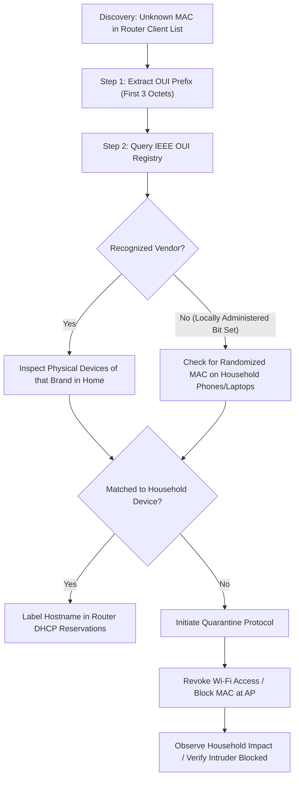

# Home Network Device Inventory & Asset Assessment

> **Project:** InternCircle Cybersecurity Internship – Project 04  
> **Document:** Device Inventory & Unknown Device Identification Protocol  
> **Classification:** CONFIDENTIAL / AUDIT WORKPAPER  
> **Audit Status:** Baseline Audit (Sample Template & Verification Guide)  
> **Assessor:** [Intern / Candidate Name]  
> **Date:** November 2026  

---

## 1. Executive Summary & Inventory Scope

In cybersecurity, asset discovery is the foundational pillar of the **NIST Cybersecurity Framework (CSF) Identify (ID) function**. An organization or individual cannot secure what they cannot see. In a home network environment, unmanaged, outdated, or unauthorized devices represent latent attack surfaces that threat actors can exploit to gain an initial foothold and perform lateral movement across the internal subnet.

This inventory documents all devices connected to the audited home local area network (LAN) and wireless local area networks (WLAN: 2.4 GHz and 5 GHz bands).

> [!IMPORTANT]
> **Privacy and Sanitization Notice:** In strict accordance with ethical cybersecurity practices, all IP addresses and MAC addresses in this document are sanitized using RFC 1918 private subnets and masked Organizationally Unique Identifiers (OUIs) (e.g., `192.168.1.10x` and `BC:D0:74:XX:XX:XX`). Never publish raw hardware identifiers or public WAN IPs in public documentation.

---

## 2. Connected Device Inventory Table

The following table reflects the audited assets discovered during the network inventory assessment. Entries marked with `[SAMPLE DATA]` serve as realistic baselines for demonstration and testing; replace them with your verified router DHCP client list during manual audit verification.

| Asset ID | Device Hostname / Identifier | Device Category | Hardware / Manufacturer | Operating System & Version | Interface | Assigned IP (Sanitized) | MAC Address (Sanitized) | Security & Patch Status | Risk Tier |
| :--- | :--- | :--- | :--- | :--- | :--- | :--- | :--- | :--- | :--- |
| **DEV-01** | `GW-ROUTER-01` | Gateway Router / AP | TP-Link / Netgear `[SAMPLE]` | Embedded Linux v1.0.4 `[SAMPLE]` | Gateway / WAN+LAN | `192.168.1.1` | `50:C7:BF:XX:XX:XX` | `[SAMPLE]` Firmware update check required; UPnP active | **HIGH** |
| **DEV-02** | `WS-DESKTOP-WIN` | Primary Workstation | Custom PC / Dell | Windows 11 Pro 23H2 | 1 Gbps Ethernet | `192.168.1.101` | `00:1A:7D:XX:XX:XX` | Fully patched; BitLocker active; Microsoft Defender active | **LOW** |
| **DEV-03** | `LT-WORK-MAC` | Work Laptop | Apple MacBook Pro | macOS Sonoma 14.5 | 5 GHz Wi-Fi | `192.168.1.102` | `F4:D4:88:XX:XX:XX` | Automatic updates enabled; FileVault active; CrowdStrike EDR | **LOW** |
| **DEV-04** | `MB-PHONE-IOS` | Personal Smartphone | Apple iPhone 14 | iOS 17.5.1 | 5 GHz Wi-Fi | `192.168.1.103` | `BC:D0:74:XX:XX:XX` | Up to date; biometric authentication active; Private Wi-Fi MAC | **LOW** |
| **DEV-05** | `MB-PHONE-AND` | Personal Smartphone | Samsung Galaxy S23 | Android 14 (OneUI 6.1) | 5 GHz Wi-Fi | `192.168.1.104` | `34:7E:5C:XX:XX:XX` | Security patch level: Current month; Google Play Protect active | **LOW** |
| **DEV-06** | `TV-LIVINGROOM` | Smart Television | LG Electronics | webOS 23 (v8.2.0) | 5 GHz Wi-Fi | `192.168.1.110` | `A8:23:FE:XX:XX:XX` | Auto-update active; legacy cloud analytics enabled | **MEDIUM** |
| **DEV-07** | `IOT-CAM-ENTR` | Security IP Camera | Reolink / Wyze `[SAMPLE]` | Proprietary RTOS v2.1 | 2.4 GHz Wi-Fi | `192.168.1.115` | `28:6D:97:XX:XX:XX` | Cloud P2P enabled; default password verified changed; flat LAN | **HIGH** |
| **DEV-08** | `IOT-SPK-ECHO` | Smart Assistant Speaker | Amazon Echo Dot 5th Gen | Fire OS 7.x | 2.4 GHz Wi-Fi | `192.168.1.116` | `68:54:5A:XX:XX:XX` | Automatic cloud updates managed by Amazon | **MEDIUM** |
| **DEV-09** | `IOT-PLUG-KASA` | Smart Power Plug | TP-Link Kasa KP115 | Firmware v1.0.11 | 2.4 GHz Wi-Fi | `192.168.1.118` | `54:AF:97:XX:XX:XX` | No local encryption; legacy IoT; communicates to AWS IoT | **MEDIUM** |
| **DEV-10** | `UNK-HOST-0A42` | **UNKNOWN DEVICE** | Unknown Vendor | Unknown | 2.4 GHz Wi-Fi | `192.168.1.142` | `82:3C:A9:XX:XX:XX` | **Unverified asset detected on DHCP client table** | **CRITICAL** |

---

## 3. Unknown & Rogue Device Identification Protocol

Detecting unknown devices on a home network requires a systematic, repeatable forensic methodology that adheres to safety boundaries. The presence of an unrecognized MAC or IP address may indicate:
1. **MAC Address Randomization:** Modern mobile OS (iOS "Private Wi-Fi Address", Android "Randomized MAC", Windows "Random Hardware Addresses") generates synthetic MACs for privacy.
2. **Forgotten Smart Home / IoT Peripherals:** Secondary micro-controllers (e.g., smart bulbs, streaming sticks, smart switches, home appliances).
3. **Neighbor or Unauthorized Guest Access:** Rogue connection resulting from weak Pre-Shared Key (PSK) or WPS exploitation.

### Step-by-Step Investigation Workflow



### Detailed Identification Procedure

#### Step 1: Router Management Inspection
1. Log into the router administrative console (`http://192.168.1.1` or `http://192.168.0.1`).
2. Navigate to **DHCP Clients List**, **Attached Devices**, or **Network Map**.
3. Record the following telemetry for each client:
   - Client Name / NetBIOS Hostname
   - Assigned IP Address
   - Physical Hardware MAC Address
   - Connection Interface (`2.4 GHz`, `5 GHz`, or `LAN Port #`)
   - Signal Strength (RSSI in dBm) or Lease Expiration Time

#### Step 2: Local Subnet Inspection (Safe Terminal Commands)
Execute passive local neighbor discovery commands in PowerShell (Windows) or Terminal (macOS/Linux). These commands query the local operating system's ARP (Address Resolution Protocol) cache without launching aggressive active network scans:

```powershell
# Windows PowerShell (Non-intrusive ARP and Neighbor discovery)
Get-NetNeighbor -AddressFamily IPv4 | Where-Object { $_.State -ne 'Permanent' } | Select-Object IPAddress, LinkLayerAddress, State

# Legacy Command Prompt
arp -a
```

#### Step 3: MAC Address OUI Lookup
The first 6 hexadecimal digits (3 octets) of a standard MAC address represent the **Organizationally Unique Identifier (OUI)** registered with the IEEE.
- **Lookup Tool:** Use the official IEEE OUI Standards Database (`https://standards-oui.ieee.org/`) or Wireshark OUI Lookup Tool.
- **Randomized MAC Check:** If the second least-significant bit of the first octet is set to `1` (e.g., `x2:`, `x6:`, `xA:`, `xE:`), the address is a **Locally Administered Address (LAA)** generated by OS privacy features.
  - *Example:* `82:3C:A9:...` has the second bit set, indicating iOS/Android Private Wi-Fi addressing. To identify the physical device, check:
    - **iOS:** Settings > Wi-Fi > (Network Name) Info (i) > Check "Private Wi-Fi Address".
    - **Android:** Settings > Network & Internet > Internet > Gear icon next to Wi-Fi > MAC address type.

#### Step 4: Physical Device Reconciliation
Perform a physical inspection of all electrical devices plugged into the premises:
- Smart TV / Streaming dongles (Chromecast, Fire TV, Roku, Apple TV).
- Smart bulbs, plugs, and ambient lighting bridges (Philips Hue, Tuya, Kasa).
- Smart home audio and voice assistants (Alexa, Google Nest, Sonos).
- Smart appliances (refrigerator, robot vacuum, washer, air purifier).
- Work and personal handheld electronics, e-readers, gaming consoles (PlayStation, Xbox, Nintendo Switch).

#### Step 5: Quarantine & Revocation Protocol for Confirmed Rogue Devices
If a device cannot be accounted for by any household member:
1. **Immediate Disconnect:** In the router management UI, navigate to **Access Control** or **MAC Filtering** and immediately block the suspect MAC address.
2. **De-authentication & PSK Rotation:** Rotate the main Wi-Fi Pre-Shared Key immediately. A blocked MAC address is easily spoofed; rotating the WPA2/WPA3 passphrase eliminates the unauthorized access vector completely.
3. **Audit Log Review:** Examine the router system log (`Syslog`) to determine the exact timestamp when the unauthorized client first completed the 4-way WPA handshake and acquired a DHCP lease.

---

## 4. Blank Device Inventory Verification Template

> [!TIP]
> **Instructions for the Assessor:** Use the blank table below during your manual router audit. Populate each row with the genuine hardware present on your network. Mask the last two octets of MAC addresses and last octet of IP addresses before saving for publication.

| Asset ID | Device Description / Room | Device Type | Hardware Vendor | Operating System | Interface (Ethernet / 2.4G / 5G) | Local IP (Masked) | MAC OUI (Masked) | Auto-Update Active? | Verified Owner |
| :--- | :--- | :--- | :--- | :--- | :--- | :--- | :--- | :--- | :--- |
| `[DEV-01]` | `[e.g., Living Room Gateway]` | `[Router/AP]` | `[e.g., TP-Link Archer]` | `[Firmware v...]` | `[Gateway WAN/LAN]` | `192.168.1.1` | `[XX:XX:XX:..]` | `[ ] Yes  [ ] No` | Self / Admin |
| `[DEV-02]` | `[e.g., Home Office PC]` | `[Desktop]` | `[e.g., Lenovo ThinkCentre]` | `[e.g., Win 11 Pro]` | `[Gigabit LAN]` | `192.168.1.xxx` | `[XX:XX:XX:..]` | `[ ] Yes  [ ] No` | Self |
| `[DEV-03]` | `[e.g., Personal Laptop]` | `[Laptop]` | `[e.g., HP Pavilion]` | `[e.g., Ubuntu 24.04]` | `[5 GHz Wi-Fi]` | `192.168.1.xxx` | `[XX:XX:XX:..]` | `[ ] Yes  [ ] No` | Self |
| `[DEV-04]` | `[e.g., Primary Mobile]` | `[Smartphone]` | `[e.g., Apple iPhone]` | `[e.g., iOS 17.x]` | `[5 GHz Wi-Fi]` | `192.168.1.xxx` | `[XX:XX:XX:..]` | `[ ] Yes  [ ] No` | Family Member |
| `[DEV-05]` | `[e.g., Smart Television]` | `[Entertainment]` | `[e.g., Samsung]` | `[e.g., Tizen OS]` | `[2.4 GHz Wi-Fi]` | `192.168.1.xxx` | `[XX:XX:XX:..]` | `[ ] Yes  [ ] No` | Household |
| `[DEV-06]` | `[e.g., IoT Smart Plug]` | `[IoT / Automation]` | `[e.g., Tuya Smart]` | `[Embedded RTOS]` | `[2.4 GHz Wi-Fi]` | `192.168.1.xxx` | `[XX:XX:XX:..]` | `[ ] Yes  [ ] No` | Household |

---

## 5. Security & Device Hygiene Findings

1. **IoT Density & Surface Risk:** Consumer IoT devices represent over 40% of connected home endpoints. Nearly all consumer IoT firmware lacks host-based firewalls, local antivirus, or user-configurable security patches.
2. **Flat Subnet Hazard:** All devices (laptops containing financial documents, corporate workstations, and cheap smart plugs) share a single flat collision domain (`/24` subnet). A compromise in an unpatched IoT device allows direct line-of-sight network pivoting to high-value workstations.
3. **Recommendation:** Migrate all IoT devices and untrusted guest devices to a segregated Guest Network or dedicated VLAN with Client Isolation enabled.
