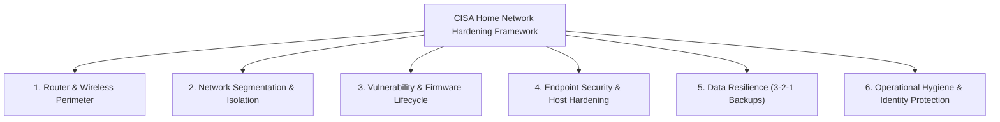
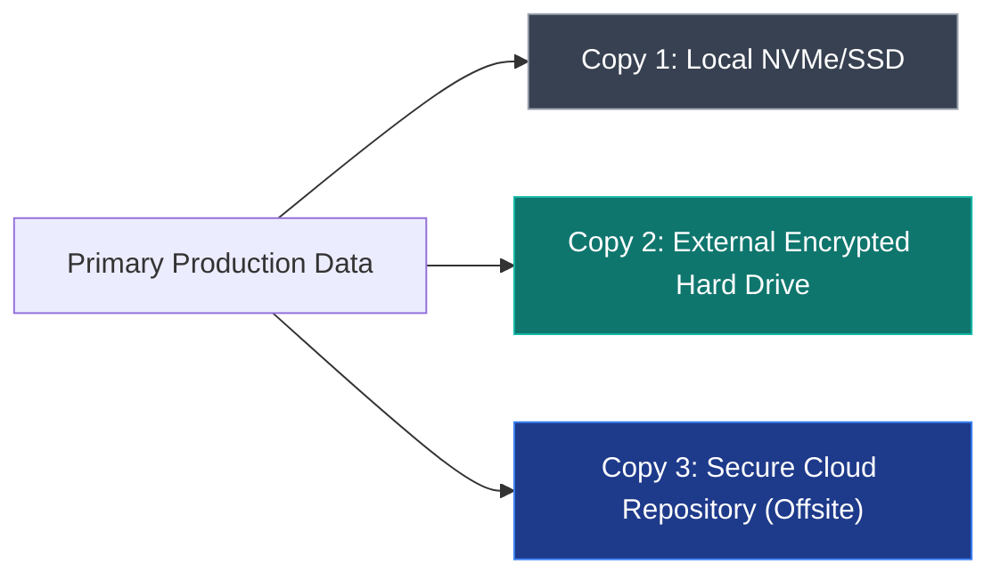

# CISA-Aligned Home Network Security Recommendations

> **Project:** InternCircle Cybersecurity Internship – Project 04  
> **Document:** Comprehensive Technical Hardening Guidelines  
> **Framework Alignment:** Cybersecurity and Infrastructure Security Agency (CISA) Home Network Security Guide, NIST SP 800-162, and CIS Critical Security Controls v8  
> **Author:** [Intern / Candidate Name]  
> **Date:** November 2026  

---

## 1. Executive Framework Alignment

Modern cybersecurity architecture operates under the principle of **Defense-in-Depth** and **Zero Trust Architecture (NIST SP 800-207)**: never trust, always verify, and assume compromise. A home network is no longer merely a conduit for consumer entertainment; it is the frontline perimeter for telework, sensitive corporate data access, banking transactions, and personal identity.

The following recommendations are structured into six tactical domains aligned directly with authoritative guidance from the **Cybersecurity and Infrastructure Security Agency (CISA)**:

---

## 2. Domain 1: Router & Wireless Perimeter Hardening

The gateway router is the primary edge firewall standing between the public Internet and internal devices. A compromised router grants an attacker total control over Domain Name System (DNS) resolution, packet inspection, and internal device scanning.

### 1.1 Migrate to WPA3-Personal or Hardened WPA2-AES
- **Technical Vulnerability:** Legacy WEP is completely broken and crackable within minutes. WPA-TKIP is susceptible to packet injection and collision attacks. WPA2-Personal (PSK) relies on a 4-way handshake that an attacker can capture passively (or trigger via de-authentication frames) and crack offline using dictionary and GPU-accelerated hashcat attacks without interacting with the router again.
- **Remediation Specification:**
  - Transition wireless security to **WPA3-Personal (SAE - Simultaneous Authentication of Equals)**. SAE uses dragonfly key exchange, providing forward secrecy and rendering passive handshake cracking mathematically infeasible.
  - If legacy devices do not support WPA3, select **WPA2/WPA3 Mixed Mode** (Transitional Mode) and mandate **AES-CCMP encryption**. Explicitly disable TKIP.
  - Enable **Protected Management Frames (PMF / 802.11w)** to prevent wireless de-authentication denial-of-service and man-in-the-middle attacks.

### 1.2 Implement High-Entropy Wi-Fi Passphrases
- **Technical Vulnerability:** Short passphrases (<12 characters) or predictable strings based on dictionary words, phone numbers, or birthdays are rapidly compromised by offline dictionary attacks.
- **Remediation Specification:**
  - Use a passphrase of **at least 16 to 20 characters** generated via a cryptographically secure random generator or the **Diceware method** (e.g., `correct-horse-battery-staple-9#`).
  - Store the passphrase inside a secure password manager (e.g., Bitwarden, 1Password) rather than writing it on physical sticky notes near the router.

### 1.3 Eliminate Default SSIDs & Vendor Fingerprinting
- **Technical Vulnerability:** Default Service Set Identifiers (SSIDs) like `NETGEAR_5G_6B21` or `TP-LINK_Router` broadcast the hardware vendor and often the exact model to neighborhood wardrivers. Attackers cross-reference default SSIDs with public tables of default PINs, factory passwords, and known hardware-specific Common Vulnerabilities and Exposures (CVEs).
- **Remediation Specification:**
  - Rename SSIDs to neutral, non-descriptive names (e.g., `Stratosphere_5G`, `OrionNet`).
  - Do **not** include personal information, full names, street addresses, or apartment numbers in the SSID.

### 1.4 Disable Wi-Fi Protected Setup (WPS)
- **Technical Vulnerability:** WPS PIN architecture divides an 8-digit PIN into two 4-digit halves (with the final digit being an unvalidated checksum), reducing the mathematical search space from 100,000,000 possibilities to just 11,000 guesses. Tools such as `Reaver` and `PixieWPS` can crack WPS PINs within seconds to hours, exposing the plain-text WPA/WPA2 passphrase regardless of how complex the passphrase is.
- **Remediation Specification:**
  - Navigate to **Wireless Settings > WPS** and toggle WPS to **DISABLED**.
  - Disable both PIN and Push Button Configuration (PBC) modes.

### 1.5 Disable Universal Plug and Play (UPnP)
- **Technical Vulnerability:** UPnP was designed for zero-configuration convenience, allowing LAN applications (such as gaming consoles or torrent clients) to request automatic port forwarding rules from the router without user authorization. Malware or malicious browser scripts executing on an internal PC can issue UPnP SOAP requests to open arbitrary inbound firewall ports, effectively creating a persistent backdoor into the internal network.
- **Remediation Specification:**
  - Navigate to **Advanced > UPnP** and toggle the feature to **DISABLED**.
  - If specific gaming or communication ports are required, configure manual, tightly scoped port forwards rather than allowing dynamic automated pinholing.

### 1.6 Disable Remote Management & Restrict Admin Interface
- **Technical Vulnerability:** Remote Management (WAN Web Access) exposes the router login portal to the entire public Internet. Automated botnets (such as Mirai, Mozi, and Gafgyt) continuously scan IPv4 address space for open router ports (80, 443, 8080, 8443) and brute-force credentials.
- **Remediation Specification:**
  - Verify that **Remote Management / WAN Access is completely DISABLED**.
  - Restrict router administration to the local subnet, and ideally restrict management access exclusively to hardwired Ethernet connections.
  - Enable **HTTPS only** for administrative access to encrypt login credentials in transit across the local network. Set idle session timeout to 5–10 minutes.

---

## 3. Domain 2: Network Segmentation & Isolation

A flat home network represents a catastrophic architectural risk: if an insecure \$15 smart plug or compromised smart TV is hacked, the threat actor has unrestricted line-of-sight network access to work laptops, Network Attached Storage (NAS), and personal devices.

### 2.1 Deploy a Dedicated Guest Network for Untrusted & IoT Devices
- **Architectural Rationale:** CISA strongly advocates creating separate virtual or physical network segments for different trust tiers.
- **Three-Tier Home Segmentation Model:**

| Network Segment | Target Assets | Access Policy | Firewall Rules |
| :--- | :--- | :--- | :--- |
| **Tier 1: Trusted Primary LAN** | Work laptops, personal computers, primary smartphones, secure backup NAS | Full Internet; Inter-device file sharing; Administrative access | Isolated from Guest/IoT; Inbound WAN blocked |
| **Tier 2: IoT / Smart Home** | Smart TVs, IP cameras, smart plugs, voice assistants, robot vacuums | Outbound Internet to vendor cloud only | **AP / Client Isolation enabled; Deny all access to Tier 1 LAN** |
| **Tier 3: Visitor Guest Wi-Fi** | Guests, friends, contractor personal devices | Outbound Internet only (HTTP/HTTPS/DNS) | **AP / Client Isolation enabled; Deny all access to Tier 1 and Tier 2** |

### 2.2 Enforce AP / Client Isolation
- **Technical Specification:** Ensure the **"AP Isolation"** or **"Client Isolation"** checkbox is enabled on the Guest Wi-Fi network. This feature prevents wireless clients on the same SSID from communicating with one another, neutralizing Address Resolution Protocol (ARP) poisoning, Man-in-the-Middle (MitM) sniffing, and SMB worm propagation.

---

## 4. Domain 3: Vulnerability & Firmware Lifecycle Management

Routers and embedded network hardware are high-value targets for nation-state advanced persistent threats (APTs) and cybercriminal botnets. Outdated firmware contains unpatched vulnerabilities with public exploit code available in Metasploit.

### 3.1 Routine Firmware Auditing Cadence
- **Procedure:**
  - Establish a calendar reminder to audit router firmware **at least once every 30 to 60 days**.
  - Log into the router and perform an online check, or visit the vendor's official support portal matching your exact **hardware revision** (e.g., Version 1.0 vs Version 2.0).
  - Review release notes for security advisories and CVE patches.

### 3.2 Safe Firmware Flashing Protocol
1. Export and save the current router configuration file (`.bin` / `.conf`).
2. Always connect the PC to the router via a physical **Ethernet cable** when flashing firmware. Flashing over Wi-Fi risks packet loss or wireless drops that can corrupt the flash memory and brick the router.
3. Verify the cryptographic SHA-256 hash of the downloaded firmware file against the vendor’s published hash before applying.
4. Allow the router to reboot completely without interrupting power.

### 3.3 End-of-Life (EOL) Hardware Retirement Policy
- **The EOL Hazard:** When a hardware manufacturer designates a router as End-of-Life or End-of-Support, it ceases to receive security patches. Discovered vulnerabilities remain permanent zero-days forever.
- **Guideline:** If a router is more than 5 years old and has not received a firmware update in over 18 months, replace the unit with modern Wi-Fi 6/6E hardware receiving active software maintenance.

---

## 5. Domain 4: Endpoint Security & Host Hardening

Perimeter security is incomplete without robust endpoint defense. Every host on the network must maintain an autonomous security posture.

### 5.1 Enforce Automated Operating System Patch Management
- **Windows:** Ensure Windows Update is set to automatic. Enable "Receive updates for other Microsoft products" to patch Office and system runtimes.
- **macOS:** Enable System Settings > General > Software Update > "Install macOS updates", "Install application updates", and "Install Security Responses and system files".
- **Mobile (iOS/Android):** Enable automatic OS and App Store updates. Never use jailbroken or rooted devices on a production network.

### 5.2 Endpoint Detection & Host-Based Firewalls
- Keep **Microsoft Defender Antivirus** active with Cloud-delivered protection and Automatic sample submission enabled. Enable **Tamper Protection** to prevent malware from disabling antivirus services.
- Ensure host-based firewalls (Windows Defender Firewall / macOS Application Firewall) are turned **ON** for both Private and Public network profiles. Block unrequested inbound connections.

### 5.3 Enforce Full-Disk Encryption (FDE)
- Enable **BitLocker** on Windows 10/11 Pro/Enterprise or Device Encryption on Windows Home.
- Enable **FileVault** on macOS.
- Full-disk encryption protects data-at-rest against physical theft or offline extraction of local hard drives.

### 5.4 Disable Insecure Legacy Protocols
- **Disable SMBv1:** SMBv1 contains severe architectural vulnerabilities (e.g., EternalBlue / MS17-010). Verify SMBv1 is disabled in Windows Features.
- **Disable LLMNR & NetBIOS:** Link-Local Multicast Name Resolution (LLMNR) and NetBIOS over TCP/IP broadcast requests in cleartext, enabling internal credential harvesting via tools like Responder.

---

## 6. Domain 5: Data Resilience & 3-2-1 Backup Architecture

Backups are the ultimate defense against ransomware, hardware failure, accidental deletion, and physical disasters.

### 6.1 The 3-2-1 Rule Implementation
- **3 Copies of Data:** Keep the working copy plus two distinct backup sets.
- **2 Different Storage Media:** Store on two different physical media (e.g., primary internal SSD and external USB drive or local NAS).
- **1 Copy Offsite & Immutable:** Maintain at least one copy in a geographically separate cloud repository (e.g., encrypted cloud backup service) with **ransomware-proof immutability or 30-day revision history**.

### 6.2 Offline / Air-Gapped Storage
- Disconnect external USB backup drives when backups are not actively running. Ransomware actively searches for connected mounted drives and network shares to encrypt them alongside the host OS.

---

## 7. Domain 6: Operational Hygiene & Human Factors

Technical controls must be reinforced by sound operational security habits.

1. **Multi-Factor Authentication (MFA):** Mandate phishing-resistant MFA (Authenticator apps like Google Authenticator, Microsoft Authenticator, or FIDO2 hardware security keys) on all email, financial, cloud storage, and router management portals. Avoid SMS-based 2FA where possible due to SIM-swapping risks.
2. **Dedicated Password Manager:** Adopt an audited password manager to generate unique, 16+ character passwords for every single online account. Never reuse passwords across sites.
3. **Phishing & Social Engineering Vigilance:** Treat unsolicited communications, urgent security alerts, and unexpected file attachments with skepticism. Verify communications through secondary, trusted out-of-band channels.
4. **Periodic Security Re-Auditing:** Re-run the Home Network Security Checklist quarterly or whenever a new IoT device, router, or major endpoint is introduced into the environment.
