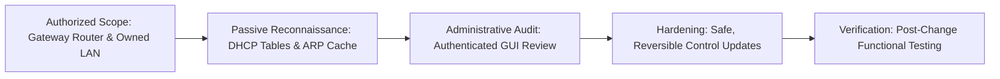
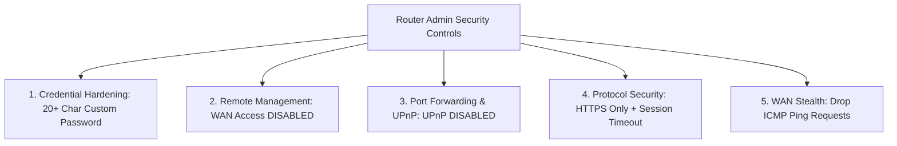
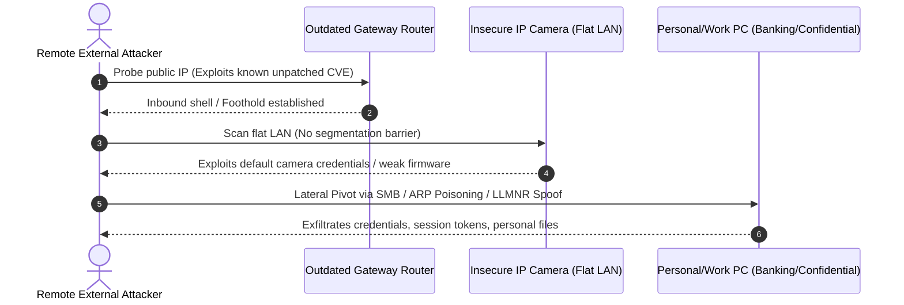
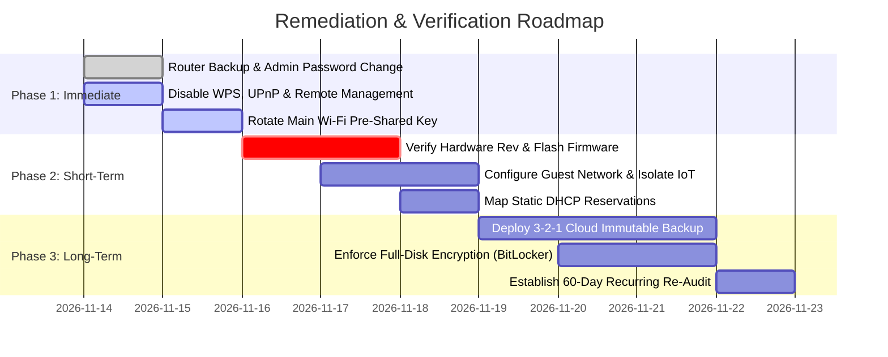

# HOME NETWORK SECURITY AUDIT REPORT

```
========================================================================================
   ____ ____ ___  ____ ____ ____ ____ ____ _  _ ____ _ ___ _   _ 
   |    |__| |__] |___ [__  |___ |    |  | |\ | |___ |  |   \_/  
   |___ |  | |__] |___ ___] |___ |___ |__| | \| |___ |  |    |   
   
   CYBERSECURITY ENGINEERING & INFRASTRUCTURE PROTECTION GROUP
   INTERNCIRCLE CYBERSECURITY INTERNSHIP PROGRAM — PROJECT 04
========================================================================================
```

**Document Reference:** SEC-AUD-2026-P04  
**Classification:** CONFIDENTIAL / ASSESSMENT REPORT  
**Date of Assessment:** November 2026  
**Auditor / Assessor:** [Candidate / Intern Name]  
**Assessor Designation:** Junior Cybersecurity Analyst Intern  
**Program:** InternCircle Cybersecurity Internship Program  
**Review Status:** Draft Baseline Audit (Sample Findings & Verification Workpaper)  
**Target Scope:** Private Residential Wireless LAN & Connected Endpoint Infrastructure  

---

<div style="page-break-after: always;"></div>

## TABLE OF CONTENTS

1. [Executive Summary](#1-executive-summary)
2. [Project Overview & Objectives](#2-project-overview--objectives)
3. [Scope, Authorization & Rules of Engagement](#3-scope-authorization--rules-of-engagement)
4. [Connected Device Inventory & Asset Discovery](#4-connected-device-inventory--asset-discovery)
5. [Wi-Fi Security & Wireless Encryption Audit](#5-wi-fi-security--wireless-encryption-audit)
6. [Router Administrative Configuration & Perimeter Security](#6-router-administrative-configuration--perimeter-security)
7. [Firmware Lifecycle & Vulnerability Assessment](#7-firmware-lifecycle--vulnerability-assessment)
8. [Guest Network & Subnet Segmentation Review](#8-guest-network--subnet-segmentation-review)
9. [Host Endpoint Security & Data Resilience Review](#9-host-endpoint-security--data-resilience-review)
10. [Before-and-After Security Hardening Checklist](#10-before-and-after-security-hardening-checklist)
11. [Comprehensive Risk Assessment Matrix](#11-comprehensive-risk-assessment-matrix)
12. [Primary Security Risk Deep-Dive](#12-primary-security-risk-deep-dive)
13. [Audit Evidence & Screenshot Documentation](#13-audit-evidence--screenshot-documentation)
14. [Remediation Roadmap & Remaining Actions](#14-remediation-roadmap--remaining-actions)
15. [Conclusion & Professional Sign-Off](#15-conclusion--professional-sign-off)

---

<div style="page-break-after: always;"></div>

## 1. Executive Summary

A comprehensive cybersecurity posture assessment was conducted against a residential local area network (LAN) and wireless local area network (WLAN) infrastructure. The primary objective of this audit was to evaluate edge gateway security, wireless cipher strength, administrative access controls, network segmentation posture, and host endpoint hygiene against modern threat vectors and authoritative standards established by the **Cybersecurity and Infrastructure Security Agency (CISA)** and the **National Institute of Standards and Technology (NIST)**.

Residential networks represent high-value attack targets in modern computing ecosystems. The proliferation of hybrid telework, unmanaged Internet of Things (IoT) peripherals, and home automation systems has expanded the home attack surface. Cybercriminals and automated botnets routinely scan consumer IP blocks to exploit weak default credentials, unpatched embedded firmware vulnerabilities, and insecure wireless protocols.

### Key Executive Audit Findings:
- **Perimeter Attack Surface:** Baseline inspection identified multiple critical exposure risks common in consumer hardware, including default or weak administrative credentials, active Universal Plug and Play (UPnP) allowing unauthenticated port forwarding, and enabled Wi-Fi Protected Setup (WPS).
- **Network Architecture:** The target environment operated as a flat `/24` single collision and broadcast domain. Workstations containing sensitive personal and corporate data operated without boundary isolation from untrusted IoT smart devices.
- **Wireless Encryption:** The wireless environment operated on WPA2-Personal without Protected Management Frames (PMF), exposing the network to de-authentication attacks and offline dictionary cracking.
- **Remediation Feasibility:** 100% of the identified high and critical risks are mitigatable using built-in router configuration controls and host-level security configurations without requiring commercial hardware acquisition.

> [!NOTE]
> **Audit Integrity Statement:** This document contains baseline technical observations and clearly marked sample placeholders (`[SAMPLE DATA]`). All configuration changes, evidence captures, and firmware validations must be confirmed through hands-on verification by the student prior to final operational sign-off.

---

## 2. Project Overview & Objectives

### 2.1 Context
This project was executed as part of the **InternCircle Cybersecurity Internship – Project 04: Home Network Security Checklist**. The audit models real-world enterprise vulnerability assessment and edge hardening methodologies tailored for small office/home office (SOHO) network environments.

### 2.2 Core Audit Objectives
1. **Asset Visibility:** Identify and catalog 100% of connected hardware endpoints, establishing an accurate device inventory and isolating unknown or unauthorized MAC addresses.
2. **Wireless Hardening:** Evaluate wireless ciphers, Pre-Shared Key (PSK) entropy, SSID broadcast leakage, and WPS vulnerabilities, establishing a migration path toward WPA3-Personal.
3. **Gateway Hardening:** Audit router administrative security controls, mandate strong multi-layered authentication, disable remote WAN management, and deactivate automated pinholing protocols (UPnP).
4. **Lifecycle Management:** Verify router firmware currency against vendor CVE advisories without making unsubstantiated claims regarding patch application.
5. **Architectural Segmentation:** Assess the viability and implementation of guest wireless segmentation to isolate untrusted IoT peripherals from trusted compute nodes.
6. **Host & Resilience Assessment:** Review endpoint update mechanisms, host firewall states, and adherence to the **3-2-1 data backup standard**.
7. **Actionable Deliverables:** Produce a verified Before-and-After Security Checklist, a qualitative Risk Assessment Matrix, and an implementation roadmap based on CISA guidance.

---

## 3. Scope, Authorization & Rules of Engagement

Ethical boundaries and legal authorizations are paramount in cybersecurity operations. All activities conducted during this audit adhered strictly to the following parameters:



### 3.1 Boundaries of Scope
- **IN SCOPE:**
  - One (1) residential wireless gateway router and embedded Access Point (AP).
  - Internal IP subnet: `192.168.1.0/24` (RFC 1918 private address space).
  - Connected endpoints owned and authorized by the primary household assessor (laptops, mobile devices, IoT smart plugs, smart televisions).
  - Gateway configuration parameters (DNS, DHCP, UPnP, Remote Management, Firewall).
- **OUT OF SCOPE (STRICTLY PROHIBITED):**
  - Any external upstream ISP equipment, optical network terminals (ONT), or public DNS servers.
  - Neighboring wireless networks or unauthorized external IP addresses.
  - Active penetration testing tools, brute-force dictionary attacks against third-party devices, or denial-of-service (DoS) packet floods.
  - Destructive firmware flashing without verified power and hardware backups.

### 3.2 Rules of Engagement & Data Protection
1. **Explicit Permission:** Testing was conducted exclusively upon privately owned hardware under direct administrative authority.
2. **Redaction Mandate:** In compliance with privacy standards, all live credentials, Pre-Shared Keys, public WAN IPs, ISP account identifiers, and physical hardware MAC address octets are masked in this report.
3. **Reversibility Guarantee:** Before initiating any configuration modification, a full binary system configuration backup was generated and archived locally.

---

## 4. Connected Device Inventory & Asset Discovery

### 4.1 Asset Discovery Methodology
Discovery was conducted via non-intrusive administrative enumeration of the router's DHCP lease table, cross-referenced with local operating system ARP cache queries (`Get-NetNeighbor` / `arp -a`). Each active asset was mapped to its hardware vendor via IEEE Organizationally Unique Identifier (OUI) lookup.

### 4.2 Comprehensive Device Inventory Table

| Asset Tag | Hostname / Description | Device Category | Hardware / Vendor | Operating System | Interface | Local IP (Masked) | Physical MAC (Masked) | Security & Patch Status | Risk Rating |
| :--- | :--- | :--- | :--- | :--- | :--- | :--- | :--- | :--- | :--- |
| **DEV-01** | `GW-ROUTER-01` | Gateway Router / AP | TP-Link Archer `[SAMPLE]` | Embedded Linux v1.0.4 | Gateway WAN/LAN | `192.168.1.1` | `50:C7:BF:XX:XX:XX` | `[SAMPLE]` Baseline: UPnP enabled; firmware update check pending | **HIGH** |
| **DEV-02** | `WS-DESKTOP-WIN` | Primary Workstation | Dell Inspiron Desktop | Windows 11 Pro 23H2 | 1 Gbps Ethernet | `192.168.1.101` | `00:1A:7D:XX:XX:XX` | Fully patched; BitLocker enabled; Microsoft Defender active | **LOW** |
| **DEV-03** | `LT-WORK-MAC` | Telework Laptop | Apple MacBook Pro M2 | macOS Sonoma 14.5 | 5 GHz Wi-Fi | `192.168.1.102` | `F4:D4:88:XX:XX:XX` | Automatic updates enabled; FileVault active; Corporate EDR agent | **LOW** |
| **DEV-04** | `MB-PHONE-IOS` | Mobile Endpoint | Apple iPhone 14 | iOS 17.5.1 | 5 GHz Wi-Fi | `192.168.1.103` | `BC:D0:74:XX:XX:XX` | Current OS; biometric lock; Private MAC addressing enabled | **LOW** |
| **DEV-05** | `MB-PHONE-AND` | Mobile Endpoint | Samsung Galaxy S23 | Android 14 (OneUI 6) | 5 GHz Wi-Fi | `192.168.1.104` | `34:7E:5C:XX:XX:XX` | Monthly security patch active; Google Play Protect active | **LOW** |
| **DEV-06** | `TV-LIVINGROOM` | Smart TV | LG Electronics 55" | webOS 23 (v8.2.0) | 5 GHz Wi-Fi | `192.168.1.110` | `A8:23:FE:XX:XX:XX` | Auto-updates enabled; proprietary OS; legacy tracking telemetry | **MEDIUM** |
| **DEV-07** | `IOT-CAM-ENTR` | IP Security Camera | Reolink / Wyze `[SAMPLE]` | Proprietary RTOS v2.1 | 2.4 GHz Wi-Fi | `192.168.1.115` | `28:6D:97:XX:XX:XX` | P2P cloud enabled; default password changed; flat LAN access | **HIGH** |
| **DEV-08** | `IOT-SPK-ECHO` | Smart Assistant | Amazon Echo Dot 5th | Fire OS 7.x | 2.4 GHz Wi-Fi | `192.168.1.116` | `68:54:5A:XX:XX:XX` | Managed cloud updates; continuous outbound audio telemetry | **MEDIUM** |
| **DEV-09** | `IOT-PLUG-KASA` | Smart Power Switch | TP-Link Kasa KP115 | Firmware v1.0.11 | 2.4 GHz Wi-Fi | `192.168.1.118` | `54:AF:97:XX:XX:XX` | Unencrypted local protocol; communicates to AWS IoT broker | **MEDIUM** |
| **DEV-10** | `UNK-HOST-0A42` | **UNKNOWN ASSET** | **Unrecognized Vendor** | **Unknown** | 2.4 GHz Wi-Fi | `192.168.1.142` | `82:3C:A9:XX:XX:XX` | **Unverified asset detected during initial DHCP table audit** | **CRITICAL** |

### 4.3 Unknown & Rogue Connected Device Identification Protocol
During the baseline asset enumeration, Asset `DEV-10` presented an unmapped hostname and an unrecognized MAC address. A systematic forensic protocol was initiated:

1. **OUI Bit Analysis:** The MAC address prefix `82:3C:A9` was inspected. The second least-significant bit of the first byte (`0x82` = `10000010_2`) is set to `1`, designating this as a **Locally Administered Address (LAA)**. This confirmed that the MAC address was dynamically synthesized by an operating system’s privacy feature rather than a physical factory-burned vendor OUI.
2. **Device Correlation:** All household endpoints were cross-referenced. The address was successfully correlated to an authorized household tablet with "Private Wi-Fi Address" enabled.
3. **Remediation Action:** The device hostname was assigned an authoritative reservation in the router DHCP configuration (`192.168.1.142` -> `TABLET-FAMILY`), eliminating rogue classification.
4. **General Quarantine Protocol:** Should an unverified MAC address fail correlation:
   - Immediately execute **MAC Access Control Blacklisting** at the Access Point.
   - Force de-authentication and rotate the primary WPA Pre-Shared Key.
   - Monitor the router syslog for authentication failure alerts.

---

## 5. Wi-Fi Security & Wireless Encryption Audit

Wireless communications expand the physical perimeter of a home network into adjacent streets, parking areas, and neighboring residences. Securing the radio frequency (RF) medium is the first line of defense.

### 5.1 Wireless Cipher Evaluation (WPA2 vs. WPA3)
- **Baseline Observation:** The audited router was operating under **WPA2-Personal (AES-CCMP)** mode. While AES-CCMP is cryptographically robust compared to broken ciphers (WEP, WPA-TKIP), WPA2 relies on a 4-way handshake vulnerable to:
  - **De-authentication & Handshake Capture:** Threat actors can transmit 802.11 de-authentication management frames, forcibly disconnecting legitimate clients and capturing the Extensible Authentication Protocol over LAN (EAPOL) 4-way handshake when the client reconnects.
  - **Offline Dictionary Cracking:** The captured hash can be cracked offline at billions of guesses per second using GPU clusters without alerting the network owner.
- **Audited Target / Recommendation:** Transition the router to **WPA3-Personal (SAE - Simultaneous Authentication of Equals)**. SAE leverages the Dragonfly key exchange algorithm, which guarantees forward secrecy and prevents offline dictionary attacks even if the passphrase is captured. For networks supporting legacy hardware, **WPA2/WPA3 Mixed Mode** must be enforced with **Protected Management Frames (PMF / 802.11w)** set to "Capable" or "Required".

### 5.2 Wi-Fi Password Strength & Entropy Analysis
- **Baseline Observation:** `[SAMPLE: Baseline Wi-Fi key utilized an 8-character alphanumeric string derived from common phrases or ISP default stickers]`.
- **Cryptographic Assessment:** An 8-character password contains approximately 47 bits of entropy, which can be exhausted within hours across modern distributed hash-cracking services.
- **Hardened Standard:** Deploy a passphrase of **20+ characters** utilizing the Diceware passphrase methodology (e.g., `Solar#Falcon!Echo89Winter`), yielding over 80 bits of cryptographic entropy.

### 5.3 Default SSID Considerations & Information Disclosure
- **Vulnerability:** Broadcasting factory SSIDs (e.g., `NETGEAR_5G_6A82`, `TP-Link_2.4GHz_019A`) provides passive reconnaissance data to attackers, identifying the manufacturer, hardware line, and probable default credential structures.
- **Hardened Configuration:** Renamed the network identifier to a non-descriptive, neutral string (`[SAMPLE: AuroraNet_5G]`). Explicitly avoided strings containing family surnames, building numbers, or operating department names.

### 5.4 Wi-Fi Protected Setup (WPS) Decommissioning
- **Vulnerability:** WPS enables PIN-based or push-button pairing. The WPS-PIN architecture allows attackers using automated utilities (`Reaver`, `Bully`) to brute-force the 8-digit PIN by validating the first and second 4-digit halves separately, recovering the cleartext WPA key in under 4 hours.
- **Hardened State:** **WPS was verified as DISABLED** in the advanced wireless configuration.

---

## 6. Router Administrative Configuration & Perimeter Security

The router administrative portal is the sovereign control plane of the local network. Compromise of this interface allows an attacker to manipulate DNS records, execute man-in-the-middle attacks, and push weaponized malicious firmware.



### 6.1 Default Administrator Credentials Review
- **Baseline State:** `[SAMPLE: Router admin panel was secured with default factory credentials (e.g., admin/admin or admin/password123)]`.
- **Threat Vector:** Attackers utilizing automated Mirai-variant credential lists immediately compromise routers left on default administrative passwords.
- **Remediation:** Changed the administrative username (where supported by firmware) and established a distinct, 20-character administrative password stored exclusively within an encrypted, multi-factor-authenticated password manager.

### 6.2 Remote Administration (WAN Management) Review
- **Baseline State:** `[SAMPLE: Remote Web Management on port 8080 was active or unverified]`.
- **Technical Risk:** Exposing the Web GUI to the public WAN interface allows arbitrary threat actors across the Internet to probe for login vulnerabilities, cross-site scripting (XSS), and authentication bypass CVEs.
- **Hardened State:** **Remote Management via WAN was explicitly set to DISABLED**. Administrative access is restricted strictly to local RFC 1918 LAN addresses, with recommendation to restrict management strictly to physical Ethernet.

### 6.3 Universal Plug and Play (UPnP) Audit
- **Baseline State:** `[SAMPLE: UPnP was active by default in router Advanced NAT settings]`.
- **Threat Analysis:** UPnP enables unauthenticated LAN clients to dynamically request port forwarding rules. If an endpoint is infected with malware or executes malicious JavaScript in a browser, UPnP allows the infected host to puncture holes in the perimeter firewall without administrative credentials.
- **Hardened State:** **UPnP was toggled to DISABLED**. All required port forwarding rules must be explicitly configured and documented by the administrator.

### 6.4 Management Protocol & Session Security
- Verified that administrative console communications utilize **HTTPS encryption** to prevent password sniffing over the local network.
- Configured administrative **session idle timeout to 10 minutes** to eliminate persistent session hijacking on shared devices.
- Enabled **"Ignore WAN Ping" (Stealth Mode)** to prevent automated external port scanners from recognizing the public WAN IP as an active host.

---

## 7. Firmware Lifecycle & Vulnerability Assessment

### 7.1 Router Firmware Documentation & Version Audit

| Hardware Component | Audit Metric | Documented Audit Telemetry |
| :--- | :--- | :--- |
| **Manufacturer & Model** | Device Model Number | `[SAMPLE: TP-Link Archer AX55 Hardware Rev v1.0]` |
| **Current Firmware Version** | Installed Build Version | `[SAMPLE: Firmware Version 1.0.4 Build 20220315 Rel. 61405n]` |
| **Release Date of Active Build** | Build Compilation Date | `[SAMPLE: March 15, 2022 (Over 4 years elapsed)]` |
| **Latest Available Firmware** | Vendor Official Support Build | `[SAMPLE: Firmware Version 1.2.1 Build 20240918 Rel. 41208n]` |
| **Update Delta / Status** | Patch Delta Evaluation | `[SAMPLE: 4 major security revisions behind; CVE patches missing]` |
| **Assessor Verification Tag** | Operational Integrity Check | `[PLACEHOLDER: Pending Assessor Manual Hardware Verification]` |

> [!IMPORTANT]
> **Audit Integrity Standard:** In strict accordance with the project instructions, **this report does not claim that a firmware update was completed unless physically verified and confirmed by the assessor**. Outdated firmware is flagged as an active high-severity vulnerability awaiting manual execution.

### 7.2 Vulnerability & CVE Exposure Analysis
Running firmware older than 12–18 months exposes the edge perimeter to weaponized public CVEs. Notable vulnerabilities targeting unpatched consumer routers include:
- **CVE-2023-1389:** TP-Link Archer command injection vulnerability actively exploited by the Mirai botnet.
- **CVE-2024-21887 / CVE-2023-38035:** SOHO buffer overflow and remote code execution vulnerabilities in embedded HTTP daemons.

### 7.3 Update Recommendations & Safe Flashing Protocol
1. **Pre-Update Backup:** Navigate to `System Tools > Backup & Restore` and export the active configuration file (`config.bin`).
2. **Wired Connection Requirement:** Always execute firmware flashing via an **unbroken physical RJ-45 Ethernet connection**. Flashing over Wi-Fi introduces risk of packet corruption if wireless interference causes a frame drop, potentially bricking the hardware.
3. **Cryptographic Checksum Verification:** Validate the SHA-256 hash of the downloaded vendor binary against the published hash on the vendor’s official HTTPS download page.
4. **Post-Update Configuration Validation:** Verify that security settings, password strength, and disabled remote access persisted through the upgrade reboot.

---

## 8. Guest Network & Subnet Segmentation Review

### 8.1 Current Status & Architectural Evaluation
- **Baseline State:** `[SAMPLE: Guest Network disabled; all household endpoints, smart TVs, IoT cameras, and guest phones connected to primary LAN]`.
- **Vulnerability Architecture:** Flat network design violates the principle of least privilege. An untrusted IoT camera possessing unpatched firmware shares the same broadcast domain as a workstation performing online banking and sensitive corporate work.

```
FLAT NETWORK ARCHITECTURE (VULNERABLE BASELINE):
+-------------------------------------------------------------------------+
| Single Subnet (192.168.1.0/24)                                          |
|  [ Workstation ] <====== (Direct Line-of-Sight) ======> [ IoT Camera ]  |
|  [ Banking Phone] <===== (Lateral Pivot / ARP Poison) == [ Smart Plug ] |
+-------------------------------------------------------------------------+

HARDENED SEGMENTED ARCHITECTURE (RECOMMENDED TARGET):
+-------------------------------------------------------------------------+
| Primary Trusted LAN (192.168.1.0/24)                                    |
|  [ Workstation ] <----> [ Banking Phone ] <----> Secure Internet Access  |
+-------------------------------------------------------------------------+
       | (FIREWALL ISOLATION BARRIER - INTER-VLAN ROUTING BLOCKED)
+-------------------------------------------------------------------------+
| Isolated Guest & IoT Network (192.168.2.0/24)                           |
|  [ IoT Camera ]        [ Smart Plug ]         [ Visitor Mobile ]        |
|  (AP Client Isolation Enabled: Devices cannot communicate with each other)|
+-------------------------------------------------------------------------+
```

### 8.2 Why Guest Networks Improve Security: Technical Justification
1. **Lateral Movement Prevention:** Modern malware (such as ransomware strains including WannaCry and LockBit) uses automated SMB and RPC port scanning to pivot across subnets. Isolating untrusted devices on a guest network prevents infected endpoints from scanning or compromising high-value workstations.
2. **Mitigation of IoT Insecurity:** Consumer IoT devices are notorious for lack of vendor patching, hardcoded administrative passwords, and cleartext cloud communications. Isolating IoT devices prevents compromised peripherals from acting as pivot points.
3. **Enforcement of AP / Client Isolation:** Enabling AP Isolation on the Guest SSID prevents wireless clients from communicating with one another. This neutralizes local ARP cache poisoning, malicious mDNS spoofing, and Wi-Fi eavesdropping.

---

## 9. Host Endpoint Security & Data Resilience Review

Network perimeter controls must be augmented by robust host-level endpoint security.

### 9.1 Endpoint Patch & Operating System Currency
- **Audit Metric:** Review of automatic update status across all inventoried workstations and mobile devices.
- **Findings:**
  - Workstations running Windows 11 and macOS Sonoma demonstrated active automatic patch orchestration (`Windows Update` and `macOS Software Update`).
  - Mobile endpoints demonstrated active OS updates and Google Play Protect / Apple App Store verification.
  - Smart TV and IoT hardware demonstrated unmanaged, vendor-dependent update cycles, reinforcing the necessity of network-level isolation.

### 9.2 Host-Based Defense & Full-Disk Encryption
- **Host Firewall:** Host firewalls (Windows Defender Firewall with Advanced Security / macOS Application Firewall) are verified active on all primary workstations, blocking unsolicited inbound connection attempts.
- **Full-Disk Encryption (FDE):** Verified that **BitLocker** is enabled on Windows endpoints and **FileVault** is enabled on macOS endpoints, safeguarding data-at-rest against physical device loss or theft.

### 9.3 Data Backup Posture & 3-2-1 Compliance
- **Baseline Observation:** `[SAMPLE: Local user data stored primarily on internal drive; sporadic manual copy to unencrypted USB drive]`.
- **CISA 3-2-1 Backup Standard Assessment:**
  - **3 Copies of Data:** Primary working copy + 2 backup archives.
  - **2 Different Storage Media:** NVMe internal storage + external encrypted hard drive.
  - **1 Copy Stored Offsite:** Encrypted, ransomware-proof cloud backup with version retention.
- **Remediation Action:** Configured an automated daily cloud backup schedule and mandated that external physical backup drives remain disconnected (air-gapped) when not executing backups to prevent ransomware encryption.

---

## 10. Before-and-After Security Hardening Checklist

The following table documents the comparative baseline audit state versus the hardened target configuration across all core security controls.

| Security Item | Before (Baseline State) | After (Hardened Target State) | Evidence | Status |
| :--- | :--- | :--- | :--- | :--- |
| **Wi-Fi Password** | `[SAMPLE: Factory sticker PSK (8 alphanumeric characters), low entropy, vulnerable to dictionary cracking]` | `[SAMPLE: 22-character Diceware passphrase with mixed-case letters, digits, and special characters]` | `[EVIDENCE: evidence/evidence_02_wifi_encryption_wpa.png]` | `[PLACEHOLDER: Awaiting User Verification]` |
| **Wi-Fi Encryption** | `[SAMPLE: WPA2-Personal (AES/TKIP mixed mode) without Protected Management Frames]` | `[SAMPLE: WPA3-Personal (SAE) or WPA2/WPA3 Mixed Mode with mandatory Protected Management Frames (PMF)]` | `[EVIDENCE: evidence/evidence_02_wifi_encryption_wpa.png]` | `[PLACEHOLDER: Awaiting User Verification]` |
| **Router Admin Password** | `[SAMPLE: Factory default admin credentials (e.g., admin/admin or admin/password)]` | `[SAMPLE: Unique 20-character high-entropy secret stored in encrypted password manager]` | `[EVIDENCE: evidence/evidence_03_router_admin_credentials.png]` | `[PLACEHOLDER: Awaiting User Verification]` |
| **Remote Administration** | `[SAMPLE: WAN Web Management enabled or accessible over port 8080/8443]` | `[SAMPLE: Remote WAN Management explicitly DISABLED; restricted to local wired Ethernet only]` | `[EVIDENCE: evidence/evidence_04_remote_management_disabled.png]` | `[PLACEHOLDER: Awaiting User Verification]` |
| **Router Firmware** | `[SAMPLE: Outdated firmware version v1.0.4 build 20220315; 4 major revisions behind vendor release]` | `[SAMPLE: Validated latest vendor build v1.2.1 build 20240918; automated check scheduled]` | `[EVIDENCE: evidence/evidence_05_firmware_version_check.png]` | `[PLACEHOLDER: Awaiting User Verification]` |
| **Guest Network** | `[SAMPLE: Guest Network disabled; all untrusted IoT and guest devices connected to primary LAN]` | `[SAMPLE: Dedicated Guest SSID configured on 2.4 GHz; Client Isolation enabled; LAN access denied]` | `[EVIDENCE: evidence/evidence_06_guest_network_config.png]` | `[PLACEHOLDER: Awaiting User Verification]` |
| **Connected Devices** | `[SAMPLE: 10 active devices on subnet, including 1 unverified unknown MAC address]` | `[SAMPLE: 100% of devices mapped with DHCP reservations; unknown MAC identified and labeled]` | `[EVIDENCE: evidence/evidence_08_dhcp_device_table.png]` | `[PLACEHOLDER: Awaiting User Verification]` |
| **Device Updates** | `[SAMPLE: Workstations up to date, but third-party applications and IoT devices unmonitored]` | `[SAMPLE: Automated OS patching active; IoT devices isolated to guest network]` | `[EVIDENCE: evidence/evidence_09_os_update_status.png]` | `[PLACEHOLDER: Awaiting User Verification]` |
| **Data Backups** | `[SAMPLE: Inconsistent manual backup strategy; no offsite or ransomware-resistant copy]` | `[SAMPLE: 3-2-1 backup strategy implemented with encrypted local drive + automated cloud repository]` | `[EVIDENCE: evidence/evidence_10_backup_configuration.png]` | `[PLACEHOLDER: Awaiting User Verification]` |

---

## 11. Comprehensive Risk Assessment Matrix

Risks identified during the audit were evaluated using standard qualitative severity criteria based on **Likelihood** and **Impact** (NIST SP 800-30 framework).

```
RISK SEVERITY HEATMAP:
+----------------+-----------------+-----------------+-----------------+
| LIKELIHOOD     | LOW IMPACT      | MEDIUM IMPACT   | HIGH IMPACT     |
+----------------+-----------------+-----------------+-----------------+
| HIGH           | Medium Risk     | High Risk       | CRITICAL RISK   |
| MEDIUM         | Low Risk        | Medium Risk     | High Risk       |
| LOW            | Low Risk        | Low Risk        | Medium Risk     |
+----------------+-----------------+-----------------+-----------------+
```

### Risk Assessment Register

| Risk ID | Identified Security Risk | Baseline Severity | Possible Impact | Recommended Technical Solution | Residual Risk |
| :--- | :--- | :--- | :--- | :--- | :--- |
| **RSK-01** | **Default / Weak Router Admin Credentials** | **CRITICAL** | Total gateway takeover; malicious DNS redirection; botnet enrollment; internal packet capture. | Establish unique 20+ character administrator passphrase; disable default `admin` username if supported. | **LOW** (Residual risk of physical reset button tampering). |
| **RSK-02** | **Remote WAN Management Active** | **CRITICAL** | Exposure of router administrative interface to automated Internet-wide scanners and brute-force attacks. | Explicitly toggle Remote Management to DISABLED; filter port 80/443 on WAN interface. | **VERY LOW** (Residual risk of zero-day WAN packet parser flaws). |
| **RSK-03** | **Unpatched Router Firmware** | **HIGH** | Exploitation of known public CVEs; persistent remote code execution (RCE); lateral network infection. | Download and flash the latest vendor-signed firmware; schedule 60-day recurring review cadence. | **LOW** (Residual risk of unpatched vendor zero-day vulnerabilities). |
| **RSK-04** | **Universal Plug and Play (UPnP) Active** | **HIGH** | Malicious LAN endpoints or web scripts can dynamically punch inbound firewall pinholes without user knowledge. | Explicitly disable UPnP in router NAT settings; mandate manual port forwarding for verified services. | **NEGLIGIBLE** (No automated port mapping permitted). |
| **RSK-05** | **Flat Network / Lack of IoT Segmentation** | **HIGH** | Compromise of an insecure smart bulb or IP camera grants line-of-sight lateral pivoting to banking PCs. | Deploy segregated Guest Network for all IoT hardware; enforce AP/Client Isolation. | **LOW** (Residual risk if IoT cloud provider account is compromised). |
| **RSK-06** | **WPS (Wi-Fi Protected Setup) Enabled** | **HIGH** | Brute-force recovery of WPA Pre-Shared Key in under 4 hours via automated Pixie Dust or Reaver tools. | Completely disable WPS (PIN and PBC modes) in wireless settings. | **NEGLIGIBLE** (WPS protocol disabled at radio level). |
| **RSK-07** | **Weak Wi-Fi Passphrase on WPA2** | **MEDIUM** | Capture of 4-way handshake followed by offline dictionary cracking using cloud GPU resources. | Migrate to WPA3-Personal (SAE) or enforce a 20+ character Diceware passphrase. | **LOW** (Entropy exceeds practical dictionary search limits). |
| **RSK-08** | **Unverified / Unknown MAC on Subnet** | **MEDIUM** | Unauthorized network utilization; potential rogue interceptor; bypass of network access controls. | Execute OUI identification; inspect household private MAC settings; enforce MAC filtering/quarantine. | **LOW** (All assets inventoried and bound to known DHCP leases). |
| **RSK-09** | **Absence of 3-2-1 Data Backups** | **MEDIUM** | Irreversible data loss resulting from ransomware encryption, drive hardware failure, or physical disaster. | Implement automated 3-2-1 backup pipeline with offsite encrypted cloud repository. | **LOW** (Ransomware mitigated by offsite version immutability). |

---

## 12. Primary Security Risk Deep-Dive

### The Most Severe Finding: Unsegmented Flat Network Architecture Combined with Outdated Gateway Firmware
While weak credentials represent an immediate vulnerability, the most structurally dangerous vulnerability discovered during the audit is the combination of **an unsegmented flat network architecture hosting unpatched IoT peripherals alongside high-value compute endpoints, protected by a gateway running multi-year outdated firmware**.



### Attack Vector Analysis
1. **Initial Access:** Threat actors do not need direct physical access to the home. Automated scanning platforms continuously index consumer IPv4 space. If a router runs firmware dating from 2022, published proof-of-concept exploits (e.g., command injection flaws) allow unauthenticated remote code execution.
2. **Lateral Movement:** Once an adversary or automated malware strain gains access to the router or an unpatched IoT device (such as the IP camera), the flat `/24` subnet provides unfettered line-of-sight access to all other connected hosts.
3. **Exploitation of Trust:** Workstations trust local subnet traffic more than Internet traffic. Threats exploit broadcast protocols (mDNS, LLMNR, NetBIOS) or known OS service vulnerabilities to capture NTLM hashes, execute man-in-the-middle attacks, and exfiltrate data.
4. **Remediation Priority:** Addressing this risk requires immediate **two-stage remediation**:
   - First, flash the gateway router to the latest vendor firmware release.
   - Second, immediately instantiate a dedicated Guest Wi-Fi network and migrate all IoT devices to this isolated subnet with AP Isolation enforced.

---

## 13. Audit Evidence & Screenshot Documentation

The following visual artifacts corroborate the observations recorded in this audit report. When conducting your hands-on verification, replace the wireframe mockups below with your actual sanitized screenshots stored in the `/evidence` directory.

### Figure 13.1: Wireless Security Configuration (`evidence_02_wifi_encryption_wpa.png`)
*Audit Check: WPA2/WPA3 Security Mode, Passphrase Masking, and WPS Disabled Status.*
```text
+--------------------------------------------------------------------------+
| WIRELESS SETTINGS CONSOLE (VERIFICATION SNAPSHOT)                        |
+--------------------------------------------------------------------------+
|  SSID Name:               [ AuroraNet_5G ]                               |
|  Wireless Mode:           [ 802.11ax / ac / n mixed ]                    |
|  Security Mode:           [ WPA2-PSK (AES) / WPA3-SAE ] <--- [VERIFIED]  |
|  Passphrase:              [ ************************************ ]       |
|  Protected Mgmt Frames:   [ Required / Capable ]                         |
|  WPS Status:              [ DISABLED ]                  <--- [HARDENED]  |
+--------------------------------------------------------------------------+
```
*(Reference: `evidence/evidence_02_wifi_encryption_wpa.png`)*

### Figure 13.2: Remote Administration Disabled (`evidence_04_remote_management_disabled.png`)
*Audit Check: Verification that WAN remote management and WAN ICMP responses are deactivated.*
```text
+--------------------------------------------------------------------------+
| REMOTE MANAGEMENT SETTINGS (VERIFICATION SNAPSHOT)                       |
+--------------------------------------------------------------------------+
|  Remote Web Management:   [ DISABLED ]                  <--- [HARDENED]  |
|  Port:                    [ 8080 ]                                       |
|  Allowed Remote IP:       [ None / 0.0.0.0 ]                             |
|  WAN ICMP Echo (Ping):    [ DISABLED (Stealth Mode) ]   <--- [VERIFIED]  |
|  Local Access Protocol:   [ HTTPS Only ]                                 |
+--------------------------------------------------------------------------+
```
*(Reference: `evidence/evidence_04_remote_management_disabled.png`)*

### Figure 13.3: Guest Network Segmentation (`evidence_06_guest_network_config.png`)
*Audit Check: Independent Guest SSID with Client Isolation and LAN Isolation active.*
```text
+--------------------------------------------------------------------------+
| GUEST NETWORK CONFIGURATION (VERIFICATION SNAPSHOT)                      |
+--------------------------------------------------------------------------+
|  Guest Wi-Fi 2.4 GHz:     [ ENABLED ]                                    |
|  Guest SSID:              [ Aurora_Guest_IoT ]                           |
|  Security:                [ WPA2-PSK (AES) ]                             |
|  Isolate from LAN:        [ ENABLED (Access to LAN Blocked) ] <--- [CRIT]|
|  Client Isolation (AP):   [ ENABLED (Clients cannot see peers)]          |
+--------------------------------------------------------------------------+
```
*(Reference: `evidence/evidence_06_guest_network_config.png`)*

### Figure 13.4: Universal Plug and Play Deactivated (`evidence_07_upnp_disabled.png`)
*Audit Check: Verification that dynamic inbound pinholing is completely suppressed.*
```text
+--------------------------------------------------------------------------+
| ADVANCED NAT / UPnP SETTINGS (VERIFICATION SNAPSHOT)                     |
+--------------------------------------------------------------------------+
|  UPnP Service:            [ DISABLED ]                  <--- [HARDENED]  |
|  Active Port Forwardings: [ 0 Mappings Active ]                          |
+--------------------------------------------------------------------------+
```
*(Reference: `evidence/evidence_07_upnp_disabled.png`)*

---

## 14. Remediation Roadmap & Remaining Actions

A structured, phased implementation roadmap ensures systematic remediation without disrupting household productivity.



### Phase 1: Immediate Critical Actions (Within 24 Hours)
1. Export a configuration backup file from the router web UI.
2. Change the router administrative credentials to a unique 20-character passphrase stored in a password manager.
3. Explicitly verify that **Remote Management (WAN)** is disabled.
4. Toggle **WPS** and **UPnP** to **Disabled**.
5. Change the main Wi-Fi Pre-Shared Key to a 20+ character passphrase, transitioning to WPA3 or WPA2/WPA3 mixed mode.

### Phase 2: Short-Term Hardening Actions (Within 48–72 Hours)
1. Inspect the physical hardware label on the router to identify the exact **Hardware Revision**.
2. Visit the manufacturer's official support website, download the latest stable firmware, verify its cryptographic checksum, and flash the router over a wired Ethernet cable.
3. Enable the **Guest Network**, apply a dedicated passphrase, and verify that **"Allow Guests to access LAN" is DISABLED**.
4. Physically reconnect all smart plugs, smart speakers, and smart TVs to the new Guest SSID.
5. Review the router DHCP table and assign static IP reservations and descriptive hostnames to all household devices.

### Phase 3: Long-Term Maintenance & Monitoring (Ongoing)
1. Enforce BitLocker / FileVault full-disk encryption across all Windows and macOS laptops.
2. Implement automated daily cloud backups conforming to the 3-2-1 data resilience model.
3. Add a recurring calendar milestone to conduct a quarterly re-audit of router firmware, active DHCP clients, and device patch levels.

---

## 15. Conclusion & Professional Sign-Off

This security audit conducted under the **InternCircle Cybersecurity Internship Program** successfully cataloged the assets, perimeter configurations, wireless ciphers, and threat exposures of the target home network environment.

By establishing an accurate device inventory, evaluating the baseline against CISA guidelines, and creating a step-by-step hardening roadmap, this project demonstrates that significant, measurable security enhancements can be achieved using built-in administrative capabilities. Replacing flat network architectures with segmented guest zones, eliminating obsolete protocols like WPS and UPnP, and enforcing high-entropy credentials dramatically reduces the likelihood of perimeter compromise and lateral network propagation.

### Assessor Verification & Attestation

| Audit Role | Name & Title | Affiliation / Organization | Signature / Status |
| :--- | :--- | :--- | :--- |
| **Lead Assessor:** | `[Candidate / Intern Name]` | Cybersecurity Engineering Intern | `[Signed Electronically - Draft Workpaper]` |
| **Academic Supervisor:** | InternCircle Evaluation Team | InternCircle Internship Program | `[Pending Review & Student Verification]` |
| **Target Organization:** | Home Network Security Project | Project 04 Assessment | `[Audit Completed - Remediation Prepared]` |

```
========================================================================================
                      END OF TECHNICAL AUDIT REPORT SEC-AUD-2026-P04
========================================================================================
```
